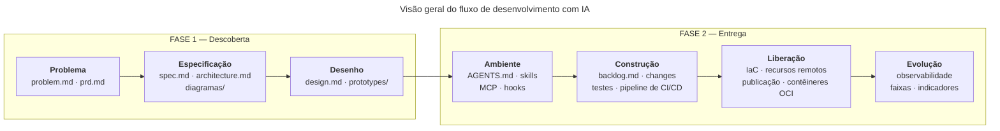

# Roteiro geral

Este repositório organiza o fluxo de desenvolvimento de uma solução de software conforme os requisitos definidos para o projeto, apoiada por agentes de inteligência artificial. Este documento é o ponto de entrada: apresenta o fluxo, as diretrizes gerais e os demais roteiros.

## Visão geral do fluxo

O fluxo tem **duas fases**, e cada fase tem as suas **atividades**. É esse o vocabulário usado em todos os artefatos da disciplina: slides, materiais de aula e roteiros.

O fluxo não termina na última atividade: a evolução o realimenta. O sinal de produção reabre a especificação, no `prd.md` e no `spec.md`, e origina novas propostas de mudança no backlog da construção. É esse laço que torna o percurso um ciclo, e não uma linha.

A liberação acontece em dois momentos: o MVP nas plataformas gerenciadas e, ao final, a versão final na AWS. A evolução ocorre entre os dois, porque a migração pressupõe a solução publicada e observável.

## Fases, atividades e roteiros

| Fase | Atividade | Roteiro correspondente |
| :---- | :---- | :---- |
| Descoberta | Problema | [Roteiro de Descoberta](https://github.com/valuedriven/devai/blob/main/.fluxo/roteiro_discovery.md), seção 1.1 |
| Descoberta | Especificação | [Roteiro de Descoberta](https://github.com/valuedriven/devai/blob/main/.fluxo/roteiro_discovery.md), seções 1.2 e 1.3 |
| Descoberta | Desenho | [Roteiro de Descoberta](https://github.com/valuedriven/devai/blob/main/.fluxo/roteiro_discovery.md), seção 1.4 |
| Entrega | Ambiente | [Roteiro de Configuração do Ambiente](https://github.com/valuedriven/devai/blob/main/.fluxo/roteiro_environment.md), complemento |
| Entrega | Construção | [Roteiro de Entrega](https://github.com/valuedriven/devai/blob/main/.fluxo/roteiro_delivery.md), seções 3 a 9 |
| Entrega | Liberação | [Roteiro de Implantação](https://github.com/valuedriven/devai/blob/main/.fluxo/roteiro_deploy.md) e [Roteiro de Migração para a AWS](https://github.com/valuedriven/devai/blob/main/.fluxo/roteiro_migracao_aws.md), complementos |
| Entrega | Evolução | [Roteiro de Evolução](https://github.com/valuedriven/devai/blob/main/.fluxo/roteiro_evolucao.md), complemento |

Há **um roteiro por fase**: o Roteiro de Descoberta e o Roteiro de Entrega. Cada um cobre a sua fase inteira. Os outros quatro documentos são **complementos**, chamados pelo Roteiro de Entrega no ponto em que cada atividade entra — a de Construção é a única descrita no próprio Roteiro de Entrega. Uma atividade pode apoiar-se em mais de um complemento, como ocorre na liberação.

## Roteiros

Há **um roteiro por fase**, e cada um cobre a sua fase inteira. Os quatro **complementos** detalham uma atividade e são chamados pelo Roteiro de Entrega no ponto em que ela entra.

| Documento | Papel | Fase · atividade | Escopo |
| :---- | :---- | :---- | :---- |
| [Roteiro de Descoberta](https://github.com/valuedriven/devai/blob/main/.fluxo/roteiro_discovery.md) | Roteiro de fase | Descoberta · Problema, Especificação e Desenho | Da definição do problema ao desenho da interface |
| [Roteiro de Entrega](https://github.com/valuedriven/devai/blob/main/.fluxo/roteiro_delivery.md) | Roteiro de fase | Entrega · as quatro atividades | Conduz a fase inteira e descreve a Construção, do backlog ao pipeline de CI/CD |
| ↳ [Roteiro de Configuração do Ambiente](https://github.com/valuedriven/devai/blob/main/.fluxo/roteiro_environment.md) | Complemento | Entrega · Ambiente | Agente instalado e configurado: regras, skills, MCP, hooks e subagentes |
| ↳ [Roteiro de Implantação](https://github.com/valuedriven/devai/blob/main/.fluxo/roteiro_deploy.md) | Complemento | Entrega · Liberação | Provisionamento por código, recursos remotos, publicação e IaC no pipeline |
| ↳ [Roteiro de Evolução](https://github.com/valuedriven/devai/blob/main/.fluxo/roteiro_evolucao.md) | Complemento | Entrega · Evolução | Observabilidade da solução e aspectos evolutivos do trabalho com agentes |
| ↳ [Roteiro de Migração para a AWS](https://github.com/valuedriven/devai/blob/main/.fluxo/roteiro_migracao_aws.md) | Complemento | Entrega · Liberação (versão final) | Contêineres OCI, ambiente completo por código e prova de reprodutibilidade |

**Ordem de execução.** Descoberta e, em seguida, Entrega. Dentro da Entrega: Ambiente, Construção, Liberação do MVP, Evolução e, por último, a versão final na AWS. Cada documento pressupõe o anterior concluído e verificado.

Documentos de apoio, consultados a partir dos roteiros:

| Documento | Para que serve |
| :---- | :---- |
| [Requisitos da Solução](https://github.com/valuedriven/devai/blob/main/.fluxo/requisitos_solucao.md) | O que a solução precisa conter e atender, e a stack de referência |
| [Catálogo de ferramentas](https://github.com/valuedriven/devai/blob/main/.fluxo/ferramentas.md) | O que cada ferramenta do ambiente faz, onde obter e como instalar |
| [Roteiros de plataforma](https://github.com/valuedriven/devai/tree/main/.fluxo/tarefas) | Passos próprios de cada plataforma, chamados pelos roteiros de implantação e de migração |

A configuração do agente é a mesma para os dois ambientes suportados, e está no Roteiro de Configuração do Ambiente. Quais ferramentas existem, o que cada uma faz e onde obtê-la estão no catálogo de ferramentas. As plataformas de cada etapa de implantação são declaradas nos requisitos da solução, e não aqui.

## Objetivos

* Clareza de escopo.
* Redução de ambiguidade.
* Consistência entre requisitos, design e implementação.
* Uso eficiente de modelos de IA como copilotos de desenvolvimento.

## Diretrizes gerais

* A saída de cada atividade é o contexto da atividade seguinte.
* Fornecer o contexto completo em um único prompt sempre que possível (one-shot prompting), em vez de distribuí-lo em várias mensagens.
* Usar documentos de exemplo já preenchidos nos prompts, referenciados por URL ou anexados, em vez de descrever a estrutura em palavras ou colar conteúdo.
* GitHub como fonte única de verdade em todo o fluxo.
* Markdown como língua franca entre pessoas e agentes.
* O que não está em arquivo no repositório não existe para o agente.
* Nenhuma mudança é concluída sem os testes correspondentes.

## Onde cada informação mora

A documentação é desacoplada em três camadas. Cada assunto tem um lugar só.

| Camada | Documento | Conteúdo |
| :---- | :---- | :---- |
| O que construir | Requisitos da solução | Requisitos funcionais e não funcionais, artefatos esperados e as plataformas de cada etapa de implantação |
| Como construir | Os dois roteiros de fase e os seus complementos, na ordem da tabela acima | Passo a passo, prompts, comandos e verificações |
| Com que ferramentas | Catálogo de ferramentas | O que cada ferramenta faz, onde obter e como instalar |
| Como configurar o agente | Roteiro de Configuração do Ambiente | MCP, skills, regras, hooks, subagentes e os passos próprios de cada agente |

Cada assunto tem um lugar só. Um passo que vale para qualquer agente fica no roteiro; um passo que muda conforme a ferramenta fica no roteiro de configuração do ambiente; o nome de uma plataforma ou de um agente fica no catálogo de ferramentas ou nos requisitos.

## Este repositório é um blueprint

Os documentos em `docs/` e a configuração deste repositório formam um **projeto de referência**: servem para mostrar a forma, a extensão e o nível de detalhe esperados de cada artefato, e são usados como exemplo nos prompts dos roteiros.

Cada pessoa que percorre o fluxo desenvolve um **projeto próprio**, com domínio próprio, problema próprio e requisitos funcionais próprios. O exemplo é referência de forma, nunca de conteúdo: reaproveitar o domínio deste repositório, que é um micro-commerce, descaracteriza o percurso.

## Documentos de exemplo

Os documentos do projeto de referência servem como exemplo preenchido de cada artefato. Os prompts dos roteiros os referenciam **por URL**: o modelo abre e lê o documento, sem que seja necessário colar o conteúdo.

* [problem.md](https://github.com/valuedriven/devai/blob/main/docs/problem.md)
* [prd.md](https://github.com/valuedriven/devai/blob/main/docs/prd.md)
* [spec.md](https://github.com/valuedriven/devai/blob/main/docs/spec.md)
* [architecture.md](https://github.com/valuedriven/devai/blob/main/docs/architecture.md)
* [design.md](https://github.com/valuedriven/devai/blob/main/docs/design.md)
* [diagramas/](https://github.com/valuedriven/devai/tree/main/docs/diagramas) — modelos de contexto, contêineres, componentes, código, implantação e pipeline
* [ada.md](https://github.com/valuedriven/devai/blob/main/docs/ada.md) — análise de decisão arquitetural, produzida no roteiro de migração
