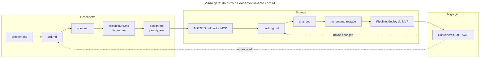

# Roteiro geral

Este repositório organiza o fluxo de desenvolvimento de uma solução web full stack apoiada por agentes de inteligência artificial. Este documento é o ponto de entrada: apresenta o fluxo, as diretrizes gerais e os demais roteiros.

## Visão geral do fluxo

## Roteiros e setups

| Documento | Para que serve |
| :---- | :---- |
| [Roteiro de Descoberta](https://github.com/valuedriven/devai/blob/main/.fluxo/roteiro_discovery.md) | Da definição do problema ao design, usando IA de uso geral |
| [Setup do ambiente](https://github.com/valuedriven/devai/blob/main/.fluxo/tarefas/setup_environment.md) | Agente de desenvolvimento no ambiente de referência (Google Antigravity) |
| [Setup do ambiente open source](https://github.com/valuedriven/devai/blob/main/.fluxo/tarefas/setup_environment_opensource.md) | Agente de desenvolvimento com providers de modelos, OmniRoute e OpenCode |
| [Roteiro de Entrega](https://github.com/valuedriven/devai/blob/main/.fluxo/roteiro_delivery.md) | Do backlog de mudanças ao MVP publicado, e daí à evolução |
| [Configuração para interação com AWS](https://github.com/valuedriven/devai/blob/main/.fluxo/tarefas/configuracao_aws.md) | Migração do MVP para a versão final |

Os dois setups são alternativos: escolha um. O Roteiro de Entrega é escrito de forma independente da ferramenta de agente e funciona igual nos dois ambientes.

## Objetivos

* Clareza de escopo.
* Redução de ambiguidade.
* Consistência entre requisitos, design e implementação.
* Uso eficiente de modelos de IA como copilotos de desenvolvimento.

## Diretrizes gerais

* A saída de cada atividade é o contexto da atividade seguinte.
* Fornecer o contexto completo em um único prompt sempre que possível (one-shot prompting), em vez de distribuí-lo em várias mensagens.
* Usar documentos de exemplo já preenchidos nos prompts, em vez de descrever a estrutura em palavras.
* GitHub como fonte única de verdade em todo o fluxo.
* Markdown como língua franca entre pessoas e agentes.
* O que não está em arquivo no repositório não existe para o agente.
* Nenhuma mudança é concluída sem os testes correspondentes.

## Onde cada informação mora

A documentação é desacoplada em três camadas. Cada assunto tem um lugar só.

| Camada | Artefato | Conteúdo |
| :---- | :---- | :---- |
| Requisitos | Requisitos do Projeto | O que a solução precisa atender: requisitos funcionais e não funcionais, artefatos esperados |
| Conceitos | Material de aula das unidades e slides | Por que cada prática existe, definições, referências bibliográficas |
| Prática | Roteiros de descoberta e de entrega, setups de ambiente e roteiro de migração | Passo a passo, prompts, comandos e verificações |

Ao consultar o fluxo, procure a camada correspondente à sua dúvida: *o que preciso construir* está nos Requisitos do Projeto, *por que faço assim* está no material de aula, *como faço* está nos roteiros.

## Estratégia de implantação em duas etapas

| Etapa | Objetivo | Plataformas | Onde é tratada |
| :---- | :---- | :---- | :---- |
| MVP | Colocar a solução no ar rapidamente, para validar fluxos de negócio ponta a ponta | Vercel, Supabase, Clerk | Roteiro de Entrega |
| Versão final | Atender integralmente aos requisitos de portabilidade e implantação | AWS, com contêineres OCI e Terraform | Roteiro de migração |

A primeira etapa privilegia velocidade de validação; a segunda, reprodutibilidade e portabilidade. A **AWS é a referência desejada** para a versão final, e a migração é executada em roteiro específico, depois que o MVP estiver funcionando.

## Este repositório é um blueprint

Os documentos em `docs/` e a configuração deste repositório formam um **projeto de referência**: servem para mostrar a forma, a extensão e o nível de detalhe esperados de cada artefato, e são usados como exemplo nos prompts dos roteiros.

Cada pessoa que percorre o fluxo desenvolve um **projeto próprio**, com domínio próprio, problema próprio e requisitos funcionais próprios. O exemplo é referência de forma, nunca de conteúdo: reaproveitar o domínio deste repositório, que é um micro-commerce, descaracteriza o exercício.

## Documentos de exemplo

Os documentos do projeto de referência servem como exemplo preenchido de cada artefato e são citados diretamente nos prompts dos roteiros:

* [problem.md](https://github.com/valuedriven/devai/blob/main/docs/problem.md)
* [prd.md](https://github.com/valuedriven/devai/blob/main/docs/prd.md)
* [spec.md](https://github.com/valuedriven/devai/blob/main/docs/spec.md)
* [architecture.md](https://github.com/valuedriven/devai/blob/main/docs/architecture.md)
* [design.md](https://github.com/valuedriven/devai/blob/main/docs/design.md)
* [diagramas/](https://github.com/valuedriven/devai/tree/main/docs/diagramas) — modelos de contexto, contêineres, componentes, código, implantação e pipeline
* [ada.md](https://github.com/valuedriven/devai/blob/main/docs/ada.md) — análise de decisão arquitetural, produzida na migração para a AWS