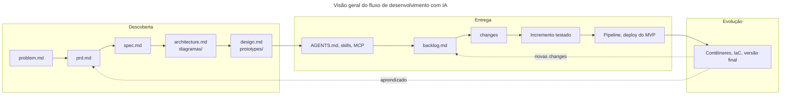

# Roteiro geral

Este repositório organiza o fluxo de desenvolvimento de uma solução web full stack apoiada por agentes de inteligência artificial. Este documento é o ponto de entrada: apresenta o fluxo, as diretrizes gerais e os demais roteiros.

## Visão geral do fluxo

## Roteiros e setups

| Documento | Para que serve |
| :---- | :---- |
| [Roteiro de Descoberta](https://github.com/valuedriven/devai/blob/main/.fluxo/roteiro_discovery.md) | Da definição do problema ao design, usando IA de uso geral |
| [Catálogo de ferramentas](https://github.com/valuedriven/devai/blob/main/.fluxo/ferramentas.md) | O que cada ferramenta do ambiente faz, onde obter e como instalar |
| [Roteiro de Configuração do Ambiente](https://github.com/valuedriven/devai/blob/main/.fluxo/roteiro_environment.md) | Regras, skills, MCP, hooks e subagentes implantados no agente escolhido, e ajustes de contexto e custo |
| [Roteiro de Entrega](https://github.com/valuedriven/devai/blob/main/.fluxo/roteiro_delivery.md) | Do backlog de mudanças ao MVP publicado e verificado |
| [Roteiro de Implantação](https://github.com/valuedriven/devai/blob/main/.fluxo/roteiro_deploy.md) | Criação dos recursos remotos e publicação do MVP nas plataformas da solução |
| [Roteiro de Evolução](https://github.com/valuedriven/devai/blob/main/.fluxo/roteiro_evolucao.md) | Depois do MVP: migração para a versão final, laço fechado com a telemetria e mudança evolutiva |
| [Roteiros de plataforma](https://github.com/valuedriven/devai/tree/main/.fluxo/tarefas) | Passos próprios de cada plataforma de implantação, chamados pelos roteiros de implantação e de evolução |

A configuração do agente é a mesma para todos os ambientes suportados, e está no Roteiro de Configuração do Ambiente. Quais ferramentas existem, o que cada uma faz e onde obtê-la estão no catálogo de ferramentas.

Os roteiros de implantação e de evolução são complementares ao Roteiro de Entrega: o primeiro traz os passos ligados às plataformas escolhidas, o segundo o que vem depois do MVP. As plataformas de cada etapa são declaradas nos requisitos do projeto, e não aqui.

## Objetivos

* Clareza de escopo.
* Redução de ambiguidade.
* Consistência entre requisitos, design e implementação.
* Uso eficiente de modelos de IA como copilotos de desenvolvimento.

## Diretrizes gerais

* A saída de cada atividade é o contexto da atividade seguinte.
* Fornecer o contexto completo em um único prompt sempre que possível (one-shot prompting), em vez de distribuí-lo em várias mensagens.
* Usar documentos de exemplo já preenchidos nos prompts, referenciados por URL ou anexados, em vez de descrever a estrutura em palavras ou colar conteúdo.
* GitHub como fonte única de verdade em todo o fluxo.
* Markdown como língua franca entre pessoas e agentes.
* O que não está em arquivo no repositório não existe para o agente.
* Nenhuma mudança é concluída sem os testes correspondentes.

## Onde cada informação mora

A documentação é desacoplada em três camadas. Cada assunto tem um lugar só.

| Camada | Documento | Conteúdo |
| :---- | :---- | :---- |
| O que construir | Requisitos do projeto | Requisitos funcionais e não funcionais, artefatos esperados e as plataformas de cada etapa de implantação |
| Como construir | Roteiros de descoberta, de entrega, de implantação e de evolução | Passo a passo, prompts, comandos e verificações |
| Com que ferramentas | Catálogo de ferramentas | O que cada ferramenta faz, onde obter e como instalar |
| Como configurar o agente | Roteiro de Configuração do Ambiente | MCP, skills, regras, hooks, subagentes e os passos próprios de cada agente |

Cada assunto tem um lugar só. Um passo que vale para qualquer agente fica no roteiro; um passo que muda conforme a ferramenta fica no roteiro de configuração do ambiente; o nome de uma plataforma ou de um agente fica no catálogo de ferramentas ou nos requisitos.

## Este repositório é um blueprint

Os documentos em `docs/` e a configuração deste repositório formam um **projeto de referência**: servem para mostrar a forma, a extensão e o nível de detalhe esperados de cada artefato, e são usados como exemplo nos prompts dos roteiros.

Cada pessoa que percorre o fluxo desenvolve um **projeto próprio**, com domínio próprio, problema próprio e requisitos funcionais próprios. O exemplo é referência de forma, nunca de conteúdo: reaproveitar o domínio deste repositório, que é um micro-commerce, descaracteriza o percurso.

## Documentos de exemplo

Os documentos do projeto de referência servem como exemplo preenchido de cada artefato. Os prompts dos roteiros os referenciam **por URL**: o modelo abre e lê o documento, sem que seja necessário colar o conteúdo.

* [problem.md](https://github.com/valuedriven/devai/blob/main/docs/problem.md)
* [prd.md](https://github.com/valuedriven/devai/blob/main/docs/prd.md)
* [spec.md](https://github.com/valuedriven/devai/blob/main/docs/spec.md)
* [architecture.md](https://github.com/valuedriven/devai/blob/main/docs/architecture.md)
* [design.md](https://github.com/valuedriven/devai/blob/main/docs/design.md)
* [diagramas/](https://github.com/valuedriven/devai/tree/main/docs/diagramas) — modelos de contexto, contêineres, componentes, código, implantação e pipeline
* [ada.md](https://github.com/valuedriven/devai/blob/main/docs/ada.md) — análise de decisão arquitetural, produzida na migração para a versão final
